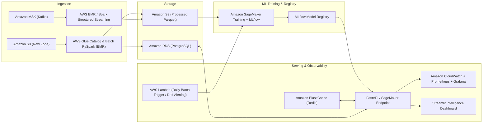

# Architecture, ML Modeling, Deployment & Monitoring Documentation

## 1. System Architecture & AWS Production Blueprint

The platform is engineered with a **cloud-agnostic local-first runtime** (Docker Compose + PySpark + SQLite/PostgreSQL + Redis + MLflow + FastAPI + Streamlit + Prometheus/Grafana) that maps 1:1 to a scalable **AWS Production Architecture**:



### AWS Service Mapping
| Local Component | AWS Production Equivalent | Purpose |
|---|---|---|
| `data/s3_datalake/` | **Amazon S3** | Partitioned raw & processed Parquet data lake |
| `spark/extract.py` schemas | **AWS Glue Data Catalog** | Centralized schema registry & Hive partitions |
| `kafka` (Docker) | **Amazon MSK** | Managed Kafka for impressions & targeting signals |
| `spark/run_etl.py` & `streaming.py` | **Amazon EMR** | Distributed PySpark batch ETL & Structured Streaming |
| `models/*/train.py` | **Amazon SageMaker** | Managed distributed model training & endpoints |
| `postgres` (Docker) | **Amazon RDS (PostgreSQL)** | Serving store for business KPIs & batch forecasts |
| `redis` (Docker) | **Amazon ElastiCache (Redis)** | Sub-10ms API prediction cache |
| Cron / EventBridge | **AWS Lambda** | Event-driven pipeline triggers & alert routing |
| `monitoring/model_drift.py` | **Amazon CloudWatch** | Log aggregation, metric alarms, & drift alerts |

---

## 2. Architecture Decisions (ADRs)

1. **Temporal Leakage Prevention**: All feature engineering pipelines (`features/audience_features.py`, `features/inventory_features.py`, `features/campaign_features.py`) strictly use chronological `shift(1).expanding()` priors and lagged observations (`avail_lag_1..30`) computed strictly before the target timestamp/campaign `start_date`. Validation uses `time_based_split` rather than random k-fold.
2. **Unified Model Evaluation Interface**: `evaluation/model_comparison.py` enforces identical metric logging (`MAE`, `RMSE`, `MAPE`, `WAPE`, `R2` for regression; `Precision`, `Recall`, `F1`, `ROC-AUC` for classification), MLflow tracking (`sqlite:///mlflow.db`), and automated `@champion` alias promotion.
3. **Graceful Local/Cloud Parity**: Storage (`utils/storage.py`), streaming (`spark/streaming.py`), and alerting (`monitoring/model_drift.py`) automatically use PostgreSQL/Redis/Kafka/S3/CloudWatch when reachable and fall back transparently to SQLite/in-memory/file-stream/local-lake/JSONL for deterministic local execution and CI testing.
4. **Cluster-Robust Causal Inference**: Because individual travelers receive multiple ad impressions, `causal_inference/ab_testing.py` and `difference_in_differences.py` use cluster-robust CR1 standard errors grouped by `traveler_id` and perform Sample Ratio Mismatch (SRM) checks on unique randomization units.

---

## 3. Feature Definitions

- **Audience Reach (`audience_reach_features.parquet`)**: `campaign_budget`, `campaign_duration`, `target_audience_size`, `country_audience_size`, `frequency_cap`, `historical_unique_reach`, `historical_impressions`, `historical_engagement`, `budget_per_day`, `budget_to_audience_ratio`, `country`, `advertising_placement`, `advertising_channel`, `campaign_objective`, `device_type`.
- **Inventory Forecasting (`inventory_features.parquet`)**: `avail_lag_{1,7,14,28,30}`, `booked_lag_{7,14}`, `avail_roll_mean_{7,28}`, `avail_roll_std_14`, `booked_roll_mean_{7,28}`, `booking_trends`, `served_lag_7`, `advertiser_demand`, cyclical encodings (`sin_doy`, `cos_doy`, `sin_dow`, `cos_dow`), `country`, `placement`.
- **Campaign Performance (`campaign_performance_features.parquet`)**: `budget`, `campaign_duration_days`, `daily_budget`, `start_month`, `start_quarter`, `start_dow`, `target_segment_size`, `target_avg_booking_freq`, `planned_avg_bid`, `channel_hist_ctr`, `channel_hist_cvr`, `advertiser_hist_campaigns`, `advertiser_hist_roas`, `target_country`, `target_age_group`, `campaign_objective`, `advertising_channel`.

---

## 4. Deployment & Monitoring Procedures

### Local Docker Deployment
```bash
docker-compose up --build -d
# Services:
# - FastAPI Swagger: http://localhost:8000/docs
# - Streamlit Dashboard: http://localhost:8501
# - MLflow UI: http://localhost:5000
# - Prometheus: http://localhost:9090
# - Grafana: http://localhost:3000 (admin/admin)
```

### AWS Cloud Deployment Procedure
1. **Infrastructure Provisioning**: Create S3 bucket (`expedia-ad-intelligence-datalake`), RDS PostgreSQL 15 instance, ElastiCache Redis cluster, and MSK cluster in `us-west-2` VPC.
2. **Container & Endpoint**: Push `Dockerfile` image to Amazon ECR; deploy FastAPI to ECS Fargate / EKS or deploy model bundles to SageMaker Real-Time Endpoints.
3. **Spark Jobs**: Submit `spark/run_etl.py` to Amazon EMR (`spark-submit --deploy-mode cluster`) reading/writing `s3a://expedia-ad-intelligence-datalake/`.
4. **Scheduled Retraining & Drift Monitoring**: Configure EventBridge daily rule -> AWS Lambda triggering SageMaker Processing/Training + `monitoring/run_monitoring.py`. Alerts flow to CloudWatch Logs (`/expedia/ad-intelligence`) and SNS when `PSI >= 0.25` or `RMSE > 1.25 * baseline_rmse`.
