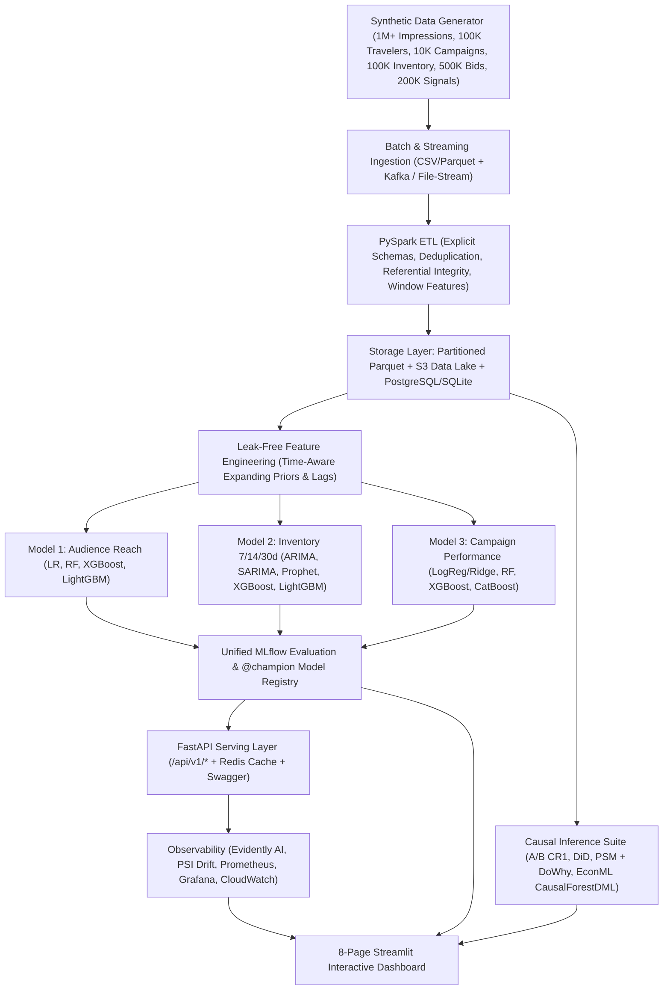

# High-Level Design & Executive Overview
## Expedia Travel Advertising Intelligence & Forecasting Platform

---

## 1. Executive Summary

The **Expedia Travel Advertising Intelligence & Forecasting Platform** is an end-to-end, production-oriented Machine Learning, Big Data Engineering, Causal Experimentation, and MLOps system. It answers six core travel advertising questions:

1. **Reach**: *How many unique travelers can an ad campaign reach?* → Model 1 ([train.py](file:///models/audience_reach/train.py))
2. **Supply**: *How much advertising inventory will be available over the next 7, 14, and 30 days?* → Model 2 ([train.py](file:///models/inventory_forecasting/train.py))
3. **Performance**: *How many impressions, clicks, conversions, and revenue will a campaign drive before launch?* → Model 3 ([train.py](file:///models/campaign_performance/train.py))
4. **Targeting**: *Which traveler segments respond causally to ads?* → Uplift Modeling ([uplift_modeling.py](file:///causal_inference/uplift_modeling.py))
5. **Budget Allocation**: *How should advertisers allocate budgets across segments and placements?* → Recommendations API ([forecasting.py](file:///api/routes/forecasting.py))
6. **Causal Impact**: *Does ML-based targeting truly lift conversion rates vs. traditional targeting?* → A/B, DiD, & PSM ([run_causal_analysis.py](file:///causal_inference/run_causal_analysis.py))

---

## 2. End-to-End Platform Data & ML Flow

---

## 3. High-Level Component Breakdown

### A. Data Generation & Ingestion
- [generate_synthetic_data.py](file:///scripts/generate_synthetic_data.py): Vectorized NumPy generator creating relational travel advertising data with reproducible seeds, realistic country/city distributions, reach saturation curves, seasonal inventory waves, and heterogeneous causal treatment effects.
- [batch_ingestion.py](file:///ingestion/batch_ingestion.py) & [kafka_producer.py](file:///ingestion/kafka_producer.py): SHA-256 idempotent batch ingestion to raw landing + S3 data lake, and Kafka real-time event publishing (with local JSONL stream fallback).

### B. PySpark Data Engineering (`spark/`)
- **Batch ETL** ([run_etl.py](file:///spark/run_etl.py)): Explicit `StructType` schema validation, null/invalid record filtering, deduplication, left-semi referential checks, window functions, and 9 business KPI aggregations (`daily_impressions`, `monthly_impressions`, `campaign_revenue`, `audience_reach_by_country`, `inventory_by_placement`, `campaign_ctr`, `campaign_cvr`, `avg_bidding_price`, `audience_engagement_by_segment`).
- **Structured Streaming** ([streaming.py](file:///spark/streaming.py)): Event-time parsing with 10-minute watermarks for late-arriving clicks and 5-minute tumbling window CTR/reach aggregations.

### C. Machine Learning Models & Unified Evaluation (`models/`, `features/`, `evaluation/`)
- **Model 1 — Audience Reach Forecasting** ([models/audience_reach/train.py](file:///models/audience_reach/train.py)):
  - **Objective**: Predict unique travelers reached (`actual_unique_reach`) for a campaign alongside calibrated 95% confidence intervals (`[ci_lower, ci_upper]`).
  - **Leak-Free Features**: Chronologically ordered expanding historical reach/impressions/engagement (`shift(1).expanding()`), target audience size, budget, duration, frequency cap, placement, country, and device type.
  - **Algorithms & Validation**: Compares `LinearRegression`, `RandomForestRegressor`, `XGBRegressor`, and `LGBMRegressor` on a strict chronological `time_based_split` using `MAE`, `RMSE`, `WAPE`, and `R²`, registering the winner as `audience_reach_forecaster` (`@champion`) in MLflow.
- **Model 2 — Inventory Forecasting** ([models/inventory_forecasting/train.py](file:///models/inventory_forecasting/train.py)):
  - Benchmarks `ARIMA`, `SARIMA`, `Prophet`, `XGBoost`, and `LightGBM` on an identical 30-day temporal holdout across `(country, placement)` series (`MAE`, `RMSE`, `MAPE`, `WAPE`) and emits recursive 7, 14, and 30-day availability forecasts.
- **Model 3 — Pre-Launch Campaign Performance** ([models/campaign_performance/train.py](file:///models/campaign_performance/train.py)):
  - Evaluates `LogisticRegression`, `RandomForest`, `XGBoost`, and `CatBoost` for high-performance classification (`Precision`, `Recall`, `F1`, `ROC-AUC`) and multi-target regression across impressions, clicks, CTR, conversions, CVR, and campaign revenue.

### D. Causal Inference & Experimentation (`causal_inference/`)
- **Cluster-Robust A/B Testing** ([ab_testing.py](file:///causal_inference/ab_testing.py)): Randomization at `traveler_id` level, Sample Ratio Mismatch (SRM) check, CR1 cluster-robust SEs for repeated exposures.
- **Difference-in-Differences** ([difference_in_differences.py](file:///causal_inference/difference_in_differences.py)): Pre/post ML rollout ATT estimation across treatment vs. comparison markets.
- **Propensity Score Matching & DoWhy** ([propensity_matching.py](file:///causal_inference/propensity_matching.py)): Logit propensity 1:1 caliper matching, SMD covariate balance verification, and DoWhy backdoor adjustment separating true causal lift from selection bias.
- **Uplift Modeling** ([uplift_modeling.py](file:///causal_inference/uplift_modeling.py)): EconML `CausalForestDML` estimating segment-level CATE to distinguish *Persuadables* from *Sure Things*, *Lost Causes*, and *Sleeping Dogs*.

### E. Production Serving, Monitoring & Visualization (`api/`, `monitoring/`, `dashboard/`)
- **FastAPI Service** ([api/main.py](file:///api/main.py)): 6 versioned `/api/v1/` endpoints with Pydantic validation, batch inference, Redis caching, latency headers, and `/metrics`.
- **Observability** ([monitoring/run_monitoring.py](file:///monitoring/run_monitoring.py)): Evidently AI data drift HTML reports, PSI & KS feature drift, RMSE/R² degradation alerts (CloudWatch + local ledger), and Prometheus/Grafana dashboards.
- **Streamlit Dashboard** ([dashboard/app.py](file:///dashboard/app.py)): 8 interactive views covering overview KPIs, all 3 model forecasts, segmentation, causal lift, model comparison, and drift monitoring.

---

## 4. Quick Command Reference
| Step | Command | Output |
|---|---|---|
| Generate 1M+ Data | `make generate-data` | `data/synthetic/*.csv` |
| Run PySpark ETL | `make etl` | `data/processed/parquet/`, `agg_*` in DB, S3 lake |
| Build Features | `make features` | `data/processed/features/*.parquet` |
| Train & Track Models | `make train` | `artifacts/models/`, `mlflow.db`, `artifacts/reports/` |
| Run Causal Suite | `make causal` | `causal_impact_report.{json,md}`, `uplift_segments.csv` |
| Run Drift Monitoring | `make monitor` | `monitoring_report.json`, Evidently HTML reports |
| Serve FastAPI | `make api` | `http://localhost:8000/docs` |
| Launch Dashboard | `make dashboard` | `http://localhost:8501` |
